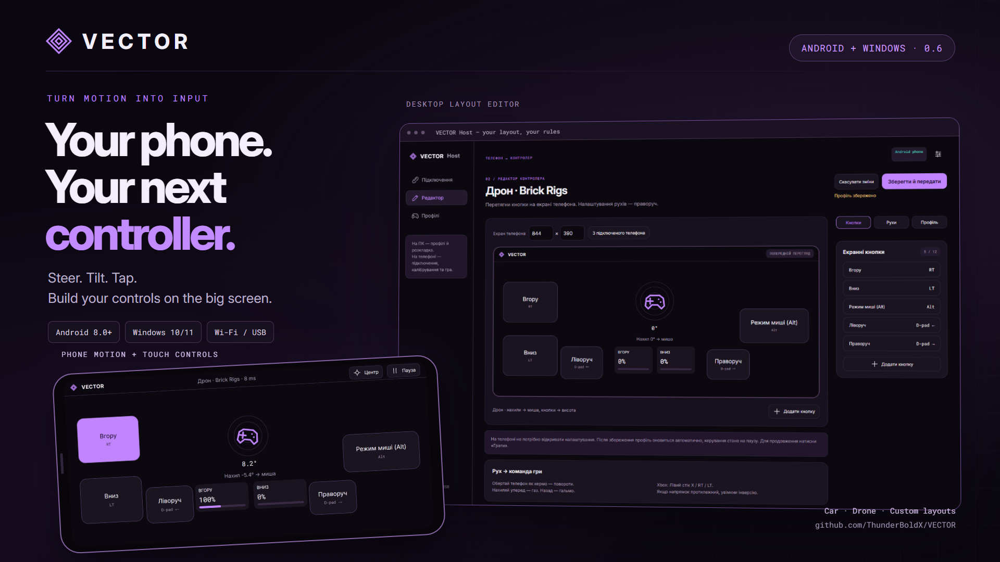
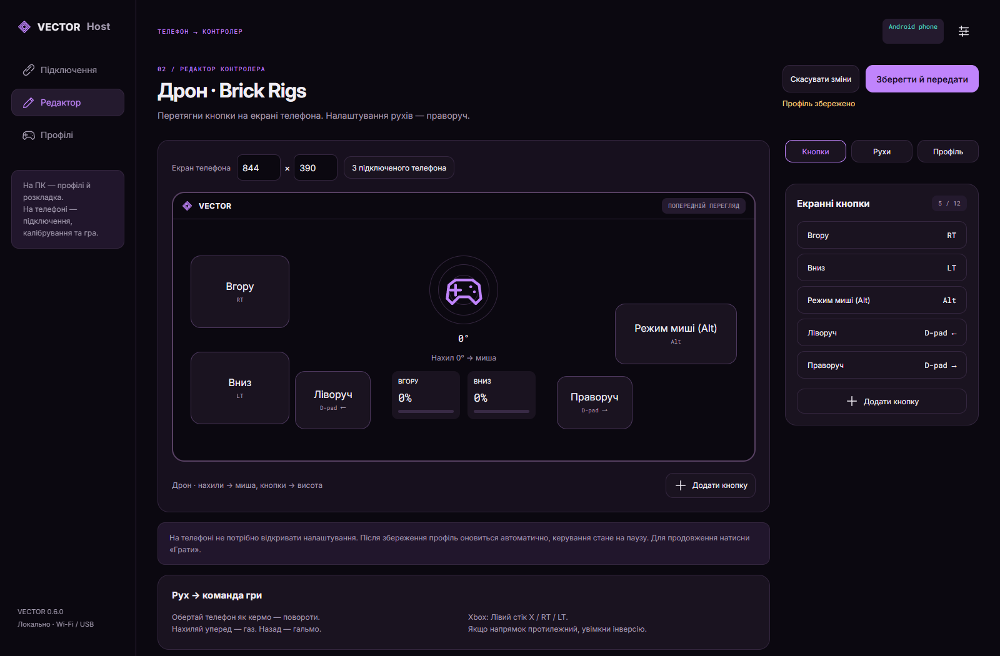
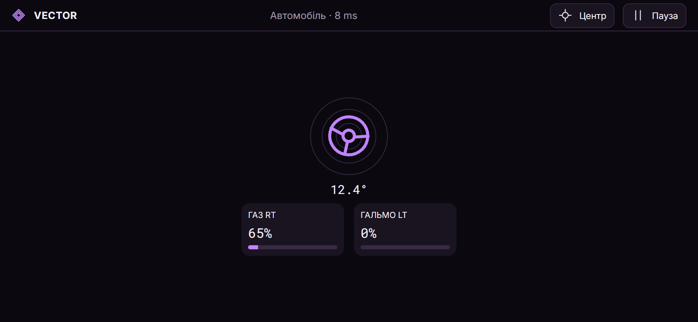
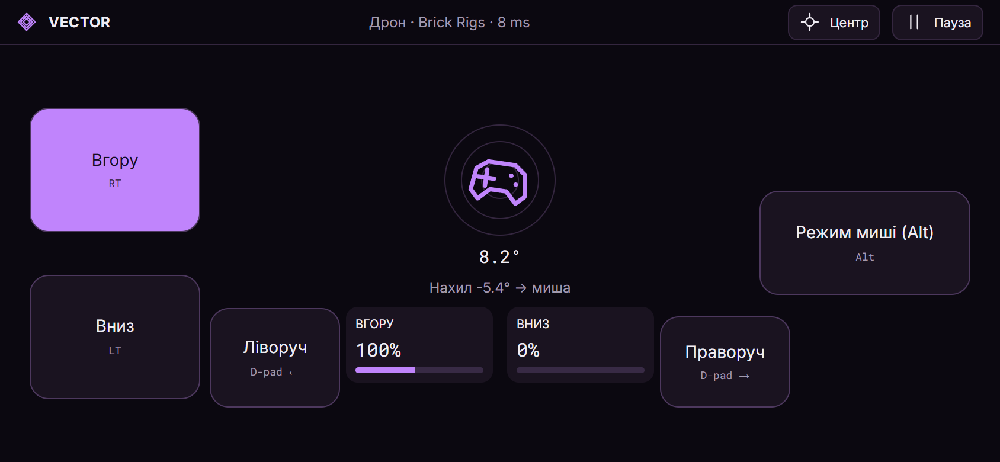
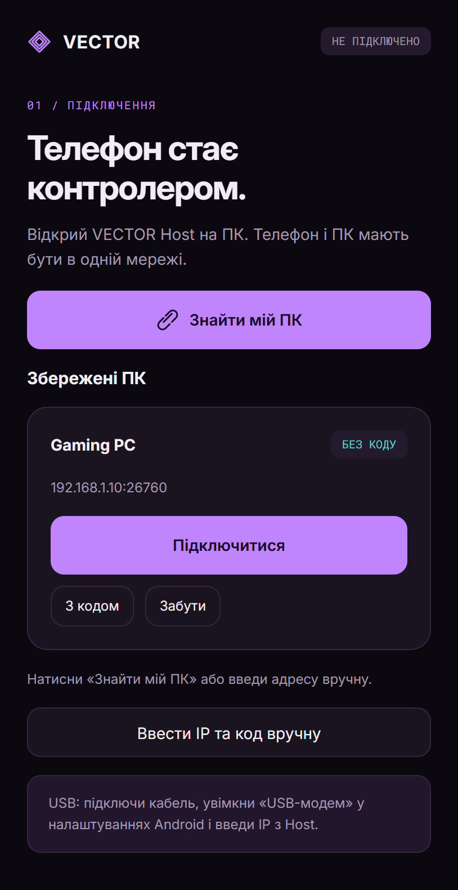
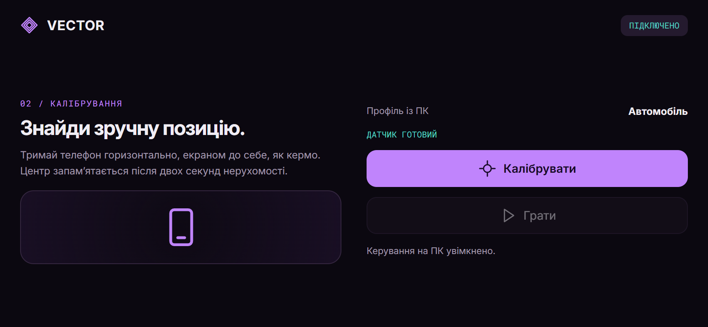
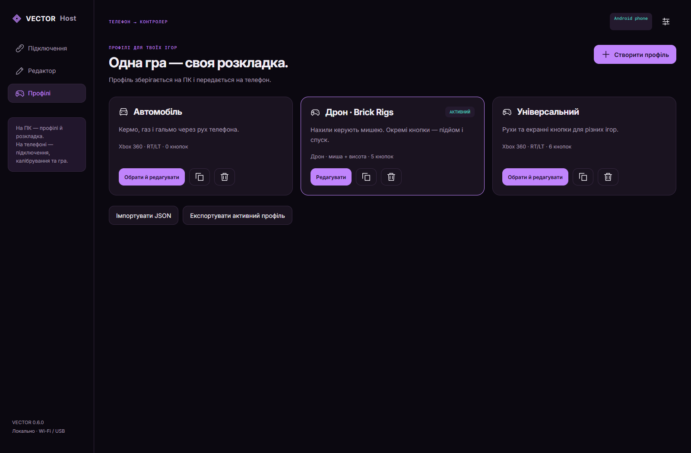
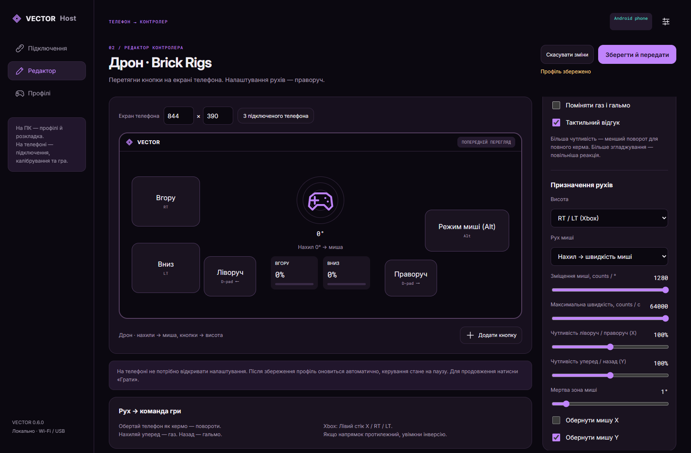

**Your phone. Your next controller.** 
Steer by turning your phone. Fly with tilt controls. Build your own button layout.

**English** · [🇺🇦 Українська](README_UK.md) 
[Download](#download) · [Screenshots](#see-it-in-action) · [Installation](docs/INSTALL.md) · [Controls](docs/CONTROLS.md) · [Build from source](docs/DEVELOPMENT.md)

VECTOR turns an Android phone into a controller for Windows games. A small app on your phone reads motion and touch input; **VECTOR Host** on your PC converts it into Xbox gamepad, mouse, keyboard or vJoy input. Configure everything on the big screen. On the phone, connect, calibrate and play.

Local Wi-Fi or Android USB tethering. No account required. The app interface is currently in Ukrainian; the guides explain the button labels in English.

## Download

Install **both** apps from the [latest release](https://github.com/ThunderBoldX/VECTOR/releases/latest):

| Device | Download | What it does |
| --- | --- | --- |
| Windows PC | **[VECTOR Host — Windows installer](https://github.com/ThunderBoldX/VECTOR/releases/download/v0.6.0/VECTOR-Host-Windows-0.6.0-Setup.exe)** | Pair your phone, edit layouts and send input to games |
| Android phone | **[VECTOR — Android APK](https://github.com/ThunderBoldX/VECTOR/releases/download/v0.6.0/VECTOR-Android-0.6.0.apk)** | Motion sensing, calibration and touch controls |
| Developers | [Source archive](https://github.com/ThunderBoldX/VECTOR/releases/download/v0.6.0/VECTOR-Source-0.6.0.zip) | Source, build scripts, documentation and tests |

Windows 10/11 **x64** · Android **8.0+** with compatible motion sensors · one private local network. 
Xbox RT/LT output also needs the ViGEmBus driver. Host includes its installer; see the [step-by-step guide](docs/INSTALL.md).

## See it in action

### Build the controller on your PC

Drag buttons onto a phone-sized canvas. Assign gamepad buttons or keyboard keys, resize controls and tune motion without reaching through menus on your phone.

### Hold the controller in your hands

<table>
<tr><td width="50%"><strong>Drive with motion</strong> Turn to steer. Tilt forward for RT, backward for LT.</td><td width="50%"><strong>Fly with a drone preset</strong> Tilt for mouse movement. Touch controls for altitude and D-pad.</td></tr>
<tr><td></td><td></td></tr>
</table>

<strong>More screenshots: pairing, calibration, profiles and sensitivity</strong>

| Pair once, reconnect later | Calibrate your comfortable position |
| --- | --- |
|  |  |

Screenshots show the actual application UI with fictional example devices and input values. RTT values in these previews are illustrative, not latency benchmarks.

## What you can do

- **Drive with your phone:** steering, analog RT/LT pedals, adjustable dead zones, curves, smoothing and direction inversion.
- **Start with a preset:** car, universal controller, or a Brick Rigs drone layout with RT, LT, Alt and D-pad left/right.
- **Make it your own:** up to 12 screen buttons per profile, drag/resize, hold/tap/toggle behavior, and profile import/export.
- **Tune each motion axis:** independent X/Y mouse sensitivity, position or velocity mapping, up to 64,000 counts/s and 1,280 counts/degree.
- **Change settings while connected:** editing pauses the phone; save on PC and press Play on the phone to continue with the new settings. No re-pairing or recalibration for changes to the same profile.
- **Remember your devices:** first-time PIN and PC approval, then authenticated reconnects without entering a code again. Forget a device to revoke access.

## First game in a few steps

1. Install Host on Windows and the APK on Android. Open Host **before** your game.
2. For Xbox output, use **Встановити Xbox-драйвер** in Host, then restart Host. Restart Windows too if the driver asks.
3. Put both devices on the same private Wi-Fi, or enable Android USB tethering.
4. Find your PC on the phone or enter the IP and PIN shown in Host. Click **Дозволити телефон** on PC.
5. Choose a profile. Hold the phone comfortably, tap **Калібрувати**, and stay still for two seconds.
6. Click **Увімкнути керування** on PC, tap **Грати** on the phone and return to the game.

[Full installation guide](docs/INSTALL.md) · [Brick Rigs & control mappings](docs/CONTROLS.md) · [Troubleshooting](docs/INSTALL.md#troubleshooting)

## A few things to know

VECTOR sends input; it does not stream your game. Game compatibility and bindings depend on the game. LT is a brake trigger; reversing depends on the game's gearbox settings. The drone preset is a starting point, not an official integration with Brick Rigs.

Use a trusted private network for initial pairing. USB uses Android's network tethering feature, not a direct USB gamepad connection. Mouse counts are software input units, not physical mouse DPI. Real latency depends on the phone, network and game.

Xbox output uses **ViGEmBus 1.22.0**, a third-party driver whose project is archived. Its installation is explicit and requires Windows administrator approval. vJoy is optional and must be installed/configured separately. Bluetooth, iOS, Linux/macOS hosts, force feedback and game-video streaming are not implemented.

## Development & releases

The UI is shared between an Android Java/WebView client and an Electron Windows Host; a C# worker handles native Windows input. See [Development](docs/DEVELOPMENT.md) for build commands, tests, architecture and how to reproduce the screenshots.

**0.6.0** fixes profile persistence after upgrades and restores live profile updates without disconnecting. [Changelog](CHANGELOG.md) · [Release notes](docs/releases/v0.6.0.md)

The release has automated coverage for motion math, pairing/retries, signed input, remembered devices, layouts and profile persistence. Automated checks do not replace physical-device or game compatibility testing; see [Testing](docs/DEVELOPMENT.md#testing).

MIT-licensed VECTOR source. Third-party components retain their own licenses; see [THIRD_PARTY_NOTICES.md](THIRD_PARTY_NOTICES.md).
