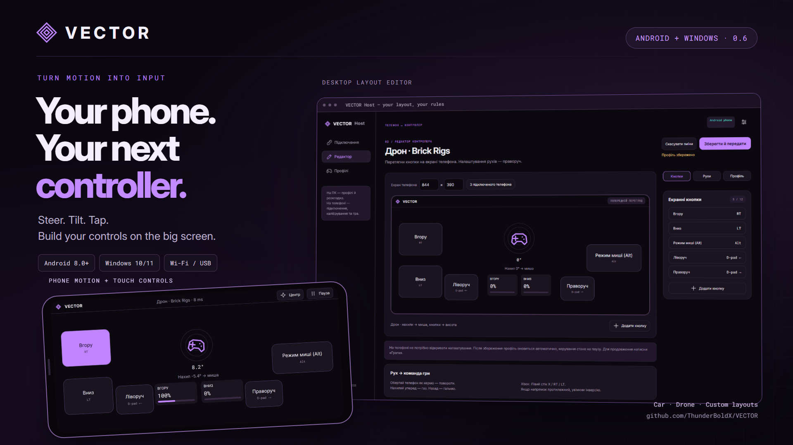
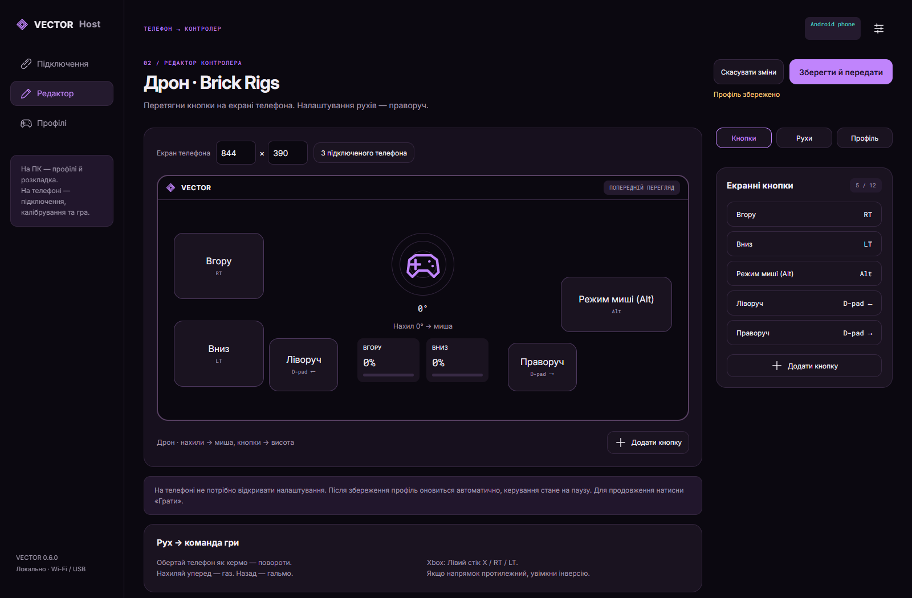
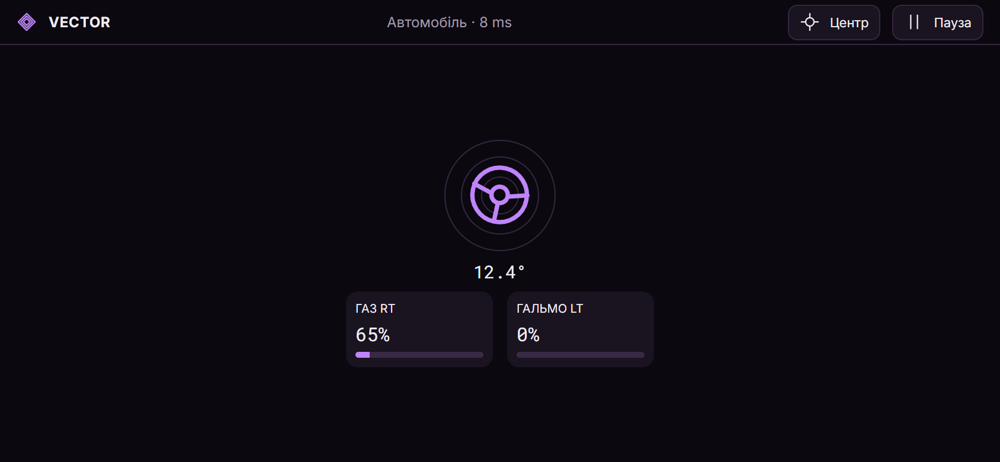
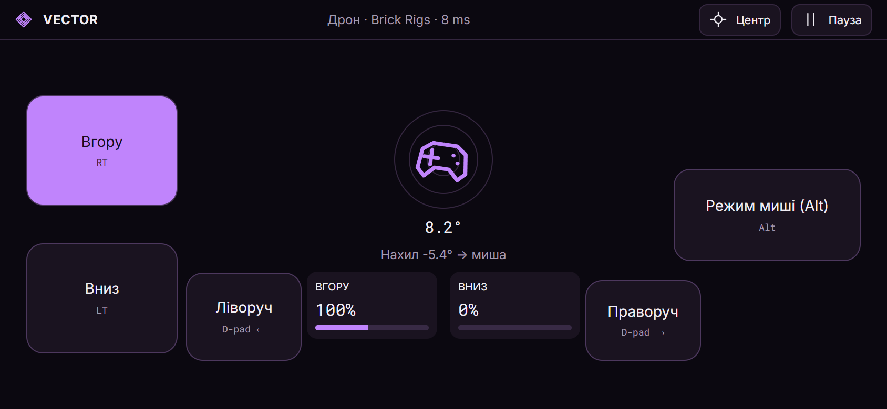
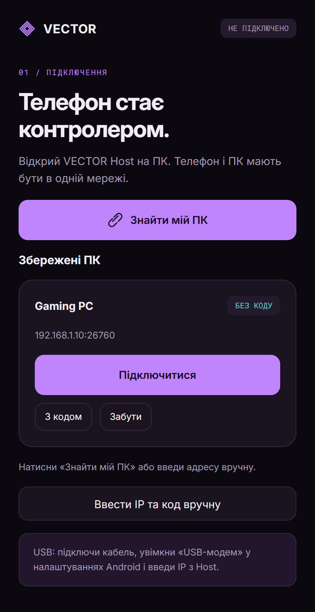
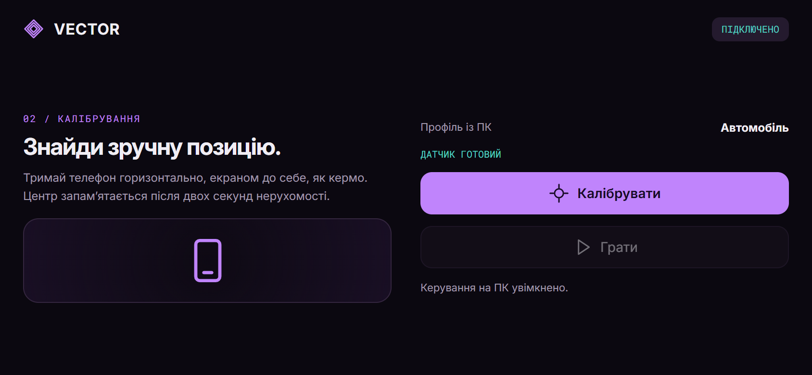
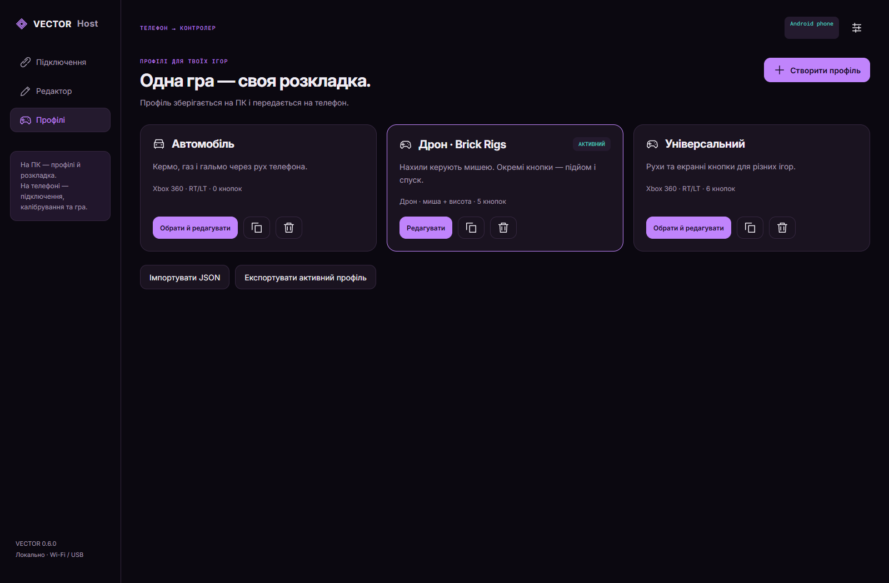
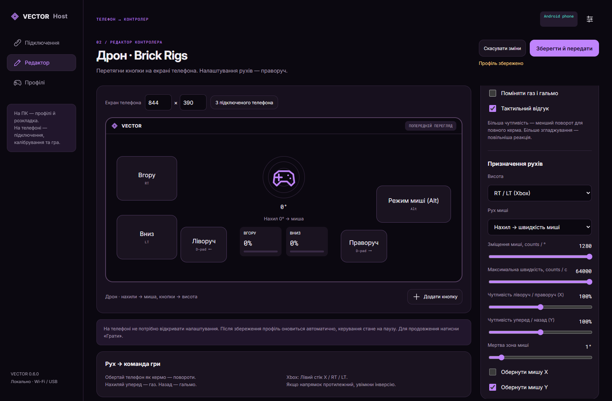

**Твій телефон. Твій наступний контролер.** 
Повертай телефон — кермуй. Нахиляй — керуй дроном. Створи власну розкладку кнопок.

[English](README.md) · **🇺🇦 Українська** 
[Завантажити](#завантажити) · [Скриншоти](#подивись-як-це-працює) · [Встановлення](docs/INSTALL_UK.md) · [Призначення](docs/CONTROLS.md) · [Збірка з коду](docs/DEVELOPMENT.md)

VECTOR перетворює Android-телефон на контролер для Windows-ігор. Телефон зчитує рухи й натискання, а **VECTOR Host** на ПК передає їх грі як Xbox-геймпад, мишу, клавіатуру або vJoy. Усі налаштування — на великому екрані. На телефоні — підключитися, відкалібрувати й грати.

Працює через локальний Wi-Fi або USB-модем Android. Обліковий запис не потрібен. Інтерфейс програми українською.

## Завантажити

Потрібні **обидві програми** з [останнього релізу](https://github.com/ThunderBoldX/VECTOR/releases/latest):

| Пристрій | Завантаження | Для чого |
| --- | --- | --- |
| Windows-ПК | **[Інсталятор VECTOR Host](https://github.com/ThunderBoldX/VECTOR/releases/download/v0.6.0/VECTOR-Host-Windows-0.6.0-Setup.exe)** | Підключення телефона, редактор і передавання команд у гру |
| Android-телефон | **[VECTOR APK](https://github.com/ThunderBoldX/VECTOR/releases/download/v0.6.0/VECTOR-Android-0.6.0.apk)** | Датчики руху, калібрування та екранні кнопки |
| Розробникам | [Архів вихідного коду](https://github.com/ThunderBoldX/VECTOR/releases/download/v0.6.0/VECTOR-Source-0.6.0.zip) | Код, документація, тести й сценарії збірки |

Windows 10/11 **x64** · Android **8.0+** із сумісними датчиками руху · одна приватна локальна мережа. 
Для Xbox RT/LT потрібен драйвер ViGEmBus. Його інсталятор доступний із Host — [докладна інструкція](docs/INSTALL_UK.md).

## Подивись, як це працює

### Збери контролер на ПК

Перетягуй кнопки на полотно з розміром екрана телефона. Призначай команди геймпада або клавіатури, змінюй розміри й налаштовуй рухи в редакторі.

### Грай із телефона

<table>
<tr><td width="50%"><strong>Автомобіль</strong> Обертання — кермо. Нахил уперед — RT, назад — LT.</td><td width="50%"><strong>Дрон</strong> Нахили — рух миші. Висота й додаткові команди — екранні кнопки.</td></tr>
<tr><td></td><td></td></tr>
</table>

<strong>Ще скриншоти: підключення, калібрування, профілі й чутливість</strong>

| Підключи один раз — далі без коду | Задай зручне нейтральне положення |
| --- | --- |
|  |  |

Це справжній інтерфейс програми з демонстраційними пристроями й показниками. Значення RTT на скриншотах наведені для прикладу, а не як вимірювання затримки.

## Можливості

- **Телефон замість керма:** аналогові RT/LT, мертві зони, криві реакції, згладжування та інверсія напрямків.
- **Три стартові профілі:** автомобіль, універсальний і дрон для Brick Rigs з RT, LT, Alt та D-pad ліворуч/праворуч.
- **Власна розкладка:** до 12 екранних кнопок, зміна позиції та розміру, утримання/коротке натискання/перемикач, імпорт і експорт профілів.
- **Окрема чутливість осей:** X та Y налаштовуються незалежно; режими зміщення і швидкості миші, до 64 000 counts/с та 1280 counts/°.
- **Налаштування без від’єднання:** редактор ставить телефон на паузу. Збережи зміни на ПК й натисни «Грати» на телефоні. Для параметрів того самого профілю не потрібні нове сполучення чи калібрування.
- **Збережені пристрої:** перший раз PIN і дозвіл на ПК, далі — захищене підключення без повторного введення коду. «Забути» відкликає доступ.

## Перша гра

1. Встанови Host на Windows, APK на Android. Запусти Host **до запуску гри**.
2. Для Xbox-виходу натисни **Встановити Xbox-драйвер**, а потім перезапусти Host. Якщо інсталятор попросить перезавантажити Windows — виконай це.
3. Підключи пристрої до одного приватного Wi-Fi або ввімкни USB-модем Android.
4. Знайди ПК на телефоні або введи IP та код із Host. На ПК натисни **Дозволити телефон**.
5. Обери профіль. Візьми телефон зручно, натисни **Калібрувати** й не рухай його дві секунди.
6. На ПК натисни **Увімкнути керування**, на телефоні — **Грати**. Повернися до гри.

[Повна інструкція](docs/INSTALL_UK.md) · [Brick Rigs та призначення](docs/CONTROLS.md) · [Якщо щось не працює](docs/INSTALL_UK.md#якщо-щось-не-працює)

## Що варто знати

VECTOR передає керування, а не відео гри. Сумісність і призначення залежать від конкретної гри. LT передає гальмо; задній хід залежить від коробки передач у грі. Профіль дрона — стартова розкладка, а не офіційна інтеграція з Brick Rigs.

Перше сполучення проводь у довіреній приватній мережі. USB працює через мережевий USB-модем Android. Counts миші — програмні одиниці введення, а не фізичні DPI. Фактична затримка залежить від телефона, мережі й гри.

Xbox-вихід використовує **ViGEmBus 1.22.0** — сторонній драйвер, проєкт якого архівований. Він встановлюється явно й потребує дозволу адміністратора Windows. vJoy — необов’язковий, встановлюється та налаштовується окремо. Bluetooth, iOS, Host для Linux/macOS, force feedback і відеостримінг не реалізовані.

## Розробка та оновлення

Android Java/WebView і Windows Electron використовують спільний інтерфейс; нативне введення Windows виконує C#-компонент. [Збірка, тести й відтворення скриншотів](docs/DEVELOPMENT.md).

**0.6.0** виправляє збереження профілів після оновлення та застосування змін без від’єднання телефона. [Історія змін](CHANGELOG.md) · [Примітки до релізу](docs/releases/v0.6.0.md).

Автоматизовані перевірки охоплюють рухи, сполучення, повторні спроби, підписані команди, збережені пристрої, розкладки й профілі. Вони не замінюють перевірку кожної гри та фізичного телефона — [докладніше](docs/DEVELOPMENT.md#testing).

Код VECTOR — MIT. Ліцензії сторонніх компонентів збережені в [THIRD_PARTY_NOTICES.md](THIRD_PARTY_NOTICES.md).
