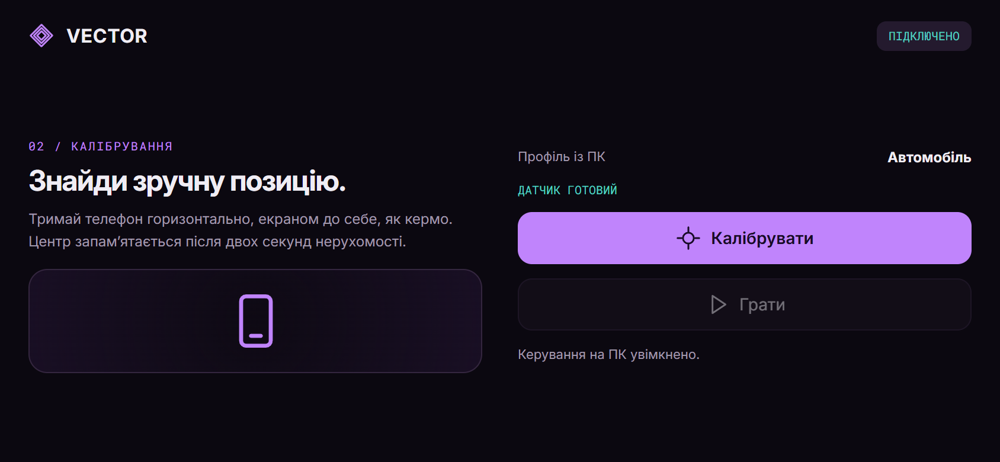
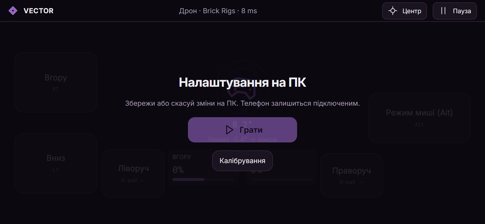

# Install VECTOR

[← Overview](../README.md) · [Українська](INSTALL_UK.md) · [Controls](CONTROLS.md)

You need the Windows Host **and** the Android app. A browser preview of the UI cannot read the phone's native motion sensors or control Windows.

## Requirements

| Component | Requirement |
| --- | --- |
| PC | Windows 10 or 11, x64 |
| Phone | Android 8.0+ with a compatible rotation-vector motion sensor; a gyroscope-equipped phone is recommended |
| Network | Same trusted private Wi-Fi, or Android USB tethering with a data-capable cable |
| Xbox output | ViGEmBus 1.22.0; its installer is available inside Host |
| vJoy output | Optional, separately installed vJoy, Device 1 with X/Y/Z axes |
| Game | Supports your chosen Xbox, keyboard/mouse or DirectInput input |

The interface is currently Ukrainian. Key labels are translated below.

## 1. Install on Windows

1. Open [Releases](https://github.com/ThunderBoldX/VECTOR/releases/latest) and download **VECTOR-Host-Windows-0.6.0-Setup.exe**.
2. Close an older Host if it is running, then run the installer. Host installs for the current Windows user.
3. Open **VECTOR Host** from the shortcut. Keep it running while you play.
4. Choose your profile in **Підключення** (Connection) or **Профілі** (Profiles).
5. For Xbox RT/LT, click **Встановити Xbox-драйвер** (Install Xbox driver). This launches the included third-party ViGEmBus installer. Windows requests administrator approval for the driver. Restart Host afterward; restart Windows if requested by the driver installer.

The Host installer and development APK are not store-distributed releases. Check the repository and file hashes if you need to verify a download; do not disable Windows or Android security protections. The ViGEmBus driver installer has its own vendor signature and license.

## 2. Install on Android

1. From the same release, download **VECTOR-Android-0.6.0.apk** to your phone.
2. Open it and, if Android asks, allow this specific browser/file manager to install the APK. You can remove that source permission afterward.
3. Install and open VECTOR. Bluetooth, camera and cloud accounts are not needed.
4. For an update, install the new APK over the existing app. Keep Host and Android on the same release. Uninstalling the app or clearing its data removes remembered PCs.

## 3. Connect the phone

### Wi-Fi

Put the phone and PC on the same private local network. Guest networks and access-point isolation can prevent communication.

On the phone, tap **Знайти мій ПК** (Find my PC). If discovery does not find it, use **Ввести IP та код вручну** (Enter IP and code manually), then enter the IPv4 address shown by Host, UDP port **26760**, and the six-digit PIN.

Keep **Запам’ятати цей ПК** (Remember this PC) enabled if you want code-free reconnects later. Click **Дозволити телефон** (Allow phone) on the PC and wait for **Профіль синхронізовано з телефоном** (Profile synchronized).

### USB cable

Connect a data-capable USB cable and enable **USB tethering / USB-модем** in Android network settings. In Host, find the IPv4 address of the Windows USB network adapter. Enter that address manually on the phone, with the same port and PIN.

USB support depends on the phone. VECTOR uses networking over Android tethering; it does not turn the phone into a USB HID controller. No ADB or developer mode is required for this connection.

### Windows firewall

Allow VECTOR Host inbound **UDP 26760**, limited to your private network/local subnet. VECTOR does not change firewall rules automatically. Do not forward this port through your router or expose Host to the public internet.

## 4. Calibrate and play

1. Open Host before launching the game, so the virtual controller is available when the game starts.
2. Pick **Автомобіль** (Car), **Дрон · Brick Rigs** (Drone), or a custom profile.
3. Hold the phone in landscape, facing you, in a comfortable playing position.
4. Tap **Калібрувати** (Calibrate) and stay still for two seconds.
5. Click **Увімкнути керування** (Enable control) on the PC.
6. Tap **Грати** (Play) on the phone and focus the game window.

Host suppresses keyboard/mouse input while its own window is focused. This prevents settings clicks from also moving your game. Return to the game after applying a profile. On a new connection, Host starts with game input disabled.

## 5. Change settings without disconnecting

Open **Редактор** (Editor) on PC: the phone pauses. Adjust controls, then click **Зберегти й передати** (Save and send). Wait for the update, tap **Грати** on the phone and return to the game.

The current connection and calibration stay in place. Re-enabling PC control is unnecessary for parameter changes to the same profile. Switching to a different profile or changing the output/height-output type disables input; enable it again after synchronization.

If writing the profile fails, the editor shows the error and retains your draft. **Скасувати зміни** (Cancel changes) restores saved values.

## Remembered devices

After the first approved PIN pairing, **Збережені ПК** (Saved PCs) appears on the phone and **Збережені телефони** (Saved phones) in Host. The phone tries to reconnect to its last saved PC when opened, or you can tap **Підключитися** (Connect) on a saved card.

A changed PC address can be resolved by local discovery. **Забути** (Forget) in Host revokes that phone's access; pairing with a PIN is then required again. Forgetting a PC on Android removes its saved credential locally. **З кодом** opens manual pairing.

Keys are protected with Android Keystore and Windows safeStorage/DPAPI. Input packets are authenticated. Initial PIN pairing exchanges a session key over the local network without transport encryption, so do it only on a trusted private network. See [Security](../SECURITY.md).

## Troubleshooting

| Symptom | What to check |
| --- | --- |
| PC not found | Same local network, no guest isolation, Host running, private-network firewall rule. Try the IP manually. |
| USB connection fails | Data-capable cable, tethering enabled, and the USB network adapter's address rather than the Wi-Fi address. |
| Missed or rejected approval | Tap Connect again. On PC, use **Новий код / скасувати запит** to cancel an old request if needed; restarting Host is unnecessary. |
| Xbox driver unavailable | Install the included driver explicitly, restart Host, restart Windows if requested. vJoy is a separate optional path. |
| Gas changes in Host but the vehicle stays still | Game sees the Xbox controller, RT/LT are bound, controller selected, gearbox in the correct gear. Start Host before the game. |
| Phone tilt does nothing | Profile synchronized, motion sensor available, calibrated, Host input enabled, phone Play pressed. |
| Mouse/keyboard does not reach the game | Focus the game window. A game running with administrator privileges may reject input from a normal user process. |
| Direction is reversed | Use steering/pitch inversion, swap pedals or invert mouse X/Y in the editor. |
| Steering starts too late | Check both VECTOR and in-game dead zones. Start angle and minimum signal are separate parameters; see [Controls](CONTROLS.md). |
| Settings seem to revert | Use 0.6 on both devices; click Save and send and check the save status. 0.6 repairs duplicated legacy backups and surfaces write errors. |
| Connection is lost | Inputs return to neutral; check network/USB tethering, reconnect and explicitly enable/play again as needed. |

The network RTT displayed by the app is a round-trip measurement, not a full sensor-to-game latency benchmark. There is no zero-latency claim.

## Verify the files

The release includes **SHA256SUMS-0.6.0.txt**. On Windows, calculate a file's SHA-256 with PowerShell and compare it with that manifest:

~~~powershell
Get-FileHash .\VECTOR-Android-0.6.0.apk -Algorithm SHA256
Get-FileHash .\VECTOR-Host-Windows-0.6.0-Setup.exe -Algorithm SHA256
~~~

## Remove VECTOR

Uninstall Host through Windows Apps and uninstall VECTOR through Android settings. A separately installed ViGEmBus/vJoy driver is a shared system component: only uninstall it if other apps do not need it. Removing Android app data also removes remembered-PC credentials.
