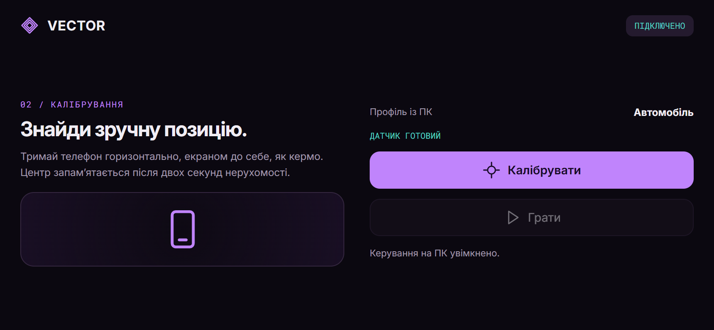
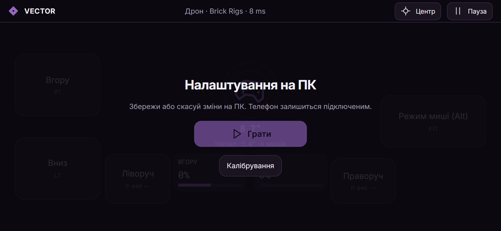

# Як встановити VECTOR

[← Про програму](../README_UK.md) · [English](INSTALL.md) · [Призначення](CONTROLS.md)

Потрібні **дві програми**: Host на Windows і APK на Android. Перегляд інтерфейсу в браузері не замінює Android-застосунок із доступом до датчиків.

## Що потрібно

| Компонент | Вимога |
| --- | --- |
| ПК | Windows 10 або 11, x64 |
| Телефон | Android 8.0+ із сумісним датчиком rotation vector; бажано телефон із гіроскопом |
| З’єднання | Один приватний Wi-Fi або USB-модем Android і кабель із передаванням даних |
| Xbox RT/LT | ViGEmBus 1.22.0; інсталятор доступний із Host |
| vJoy | Необов’язковий; окремо встановлений vJoy, Device 1 з осями X/Y/Z |
| Гра | Підтримує обраний тип введення: Xbox, клавіатура/миша або DirectInput |

## 1. Встанови Host на ПК

1. Відкрий [останній реліз](https://github.com/ThunderBoldX/VECTOR/releases/latest) і завантаж **VECTOR-Host-Windows-0.6.0-Setup.exe**.
2. Закрий старий Host, якщо він запущений. Запусти інсталятор — програма встановлюється для поточного користувача Windows.
3. Відкрий VECTOR Host із ярлика. Під час гри він має залишатися запущеним.
4. Обери профіль у розділі **Підключення** або **Профілі**.
5. Для Xbox RT/LT натисни **Встановити Xbox-драйвер**. Відкриється інсталятор ViGEmBus; Windows попросить дозвіл адміністратора саме для драйвера. Після встановлення перезапусти Host. Якщо інсталятор попросив перезавантажити Windows — виконай це.

Host і APK поширюються через GitHub, не через магазини застосунків. Для перевірки завантаження звір репозиторій і SHA-256; не вимикай захист Windows або Android. ViGEmBus має окремий підпис видавця та власну ліцензію.

## 2. Встанови APK на телефон

1. Із того самого релізу завантаж **VECTOR-Android-0.6.0.apk** на телефон.
2. Відкрий файл. Якщо Android попросить, дозволь встановлення APK для конкретного браузера чи файлового менеджера. Після встановлення цей дозвіл можна прибрати.
3. Встанови та відкрий VECTOR. Bluetooth, камера й обліковий запис не потрібні.
4. Оновлення встановлюй поверх наявної програми. Версії Host та APK мають збігатися. Видалення програми або очищення даних видаляє збережені ПК.

## 3. Підключи телефон

### Wi-Fi

Телефон і ПК мають бути в одній приватній мережі. Гостьовий Wi-Fi та ізоляція пристроїв можуть блокувати з’єднання.

На телефоні натисни **Знайти мій ПК**. Якщо ПК не знаходиться, обери **Ввести IP та код вручну** й введи IPv4-адресу з Host, порт **26760** та шестизначний код.

Залиш **Запам’ятати цей ПК** увімкненим, якщо хочеш підключатися без коду наступного разу. На ПК натисни **Дозволити телефон** і дочекайся повідомлення **Профіль синхронізовано з телефоном**.

### USB-кабель

Підключи кабель із підтримкою даних та ввімкни **USB-модем** у мережевих налаштуваннях Android. У Host знайди IPv4-адресу USB-мережевого адаптера Windows. Введи її вручну на телефоні з тим самим портом та PIN.

Підтримка залежить від телефона. VECTOR використовує мережу поверх USB-модема, а не пряме USB HID-з’єднання. ADB та режим розробника для такого підключення не потрібні.

### Брандмауер Windows

Дозволь VECTOR Host вхідні **UDP-з’єднання на порт 26760** лише для приватної мережі та локальної підмережі. Програма не змінює правила брандмауера автоматично. Не відкривай цей порт через роутер у публічний інтернет.

## 4. Відкалібруй і грай

1. Запусти Host до гри, щоб гра побачила віртуальний контролер під час запуску.
2. Обери **Автомобіль**, **Дрон · Brick Rigs** або власний профіль.
3. Тримай телефон горизонтально, екраном до себе, у зручному положенні для гри.
4. Натисни **Калібрувати** й не рухай його дві секунди.
5. На ПК натисни **Увімкнути керування**.
6. На телефоні натисни **Грати** й повернися у вікно гри.

Коли активне вікно Host, передавання клавіш і миші пригнічується. Після налаштування поверни фокус у гру. Після нового підключення Host починає з вимкненим введенням.

## 5. Змінюй налаштування без від’єднання

Відкрий **Редактор** на ПК — телефон стане на паузу. Зміни параметри й натисни **Зберегти й передати**. Дочекайся оновлення, на телефоні натисни **Грати** та повернися до гри.

Поточне з’єднання й калібрування залишаються. Для параметрів того самого профілю повторно вмикати керування на ПК не потрібно. Перемикання на інший профіль або зміна типу виходу/виходу висоти вимикає введення — після синхронізації ввімкни його знову.

При помилці запису редактор показує причину й залишає внесені зміни. **Скасувати зміни** повертає збережені значення.

## Збережені пристрої

Після першого підтвердженого сполучення з PIN на телефоні з’являться **Збережені ПК**, а в Host — **Збережені телефони**. Телефон спробує підключитися до останнього ПК під час відкриття. Також можна натиснути **Підключитися** на картці збереженого ПК.

Якщо IP змінився, пошук у локальній мережі впізнає збережений ПК. **Забути** в Host відкликає доступ телефона, після чого потрібне нове сполучення з кодом. **Забути** на телефоні видаляє локально збережений ключ ПК. **З кодом** відкриває ручне сполучення.

Ключі захищені Android Keystore і Windows safeStorage/DPAPI. Пакети введення перевіряються підписом. Перший обмін сеансовим ключем після PIN не має транспортного шифрування, тому сполучення проводь лише в довіреній приватній мережі. [Докладніше про захист](../SECURITY.md).

## Якщо щось не працює

| Проблема | Що перевірити |
| --- | --- |
| ПК не знаходиться | Одна локальна мережа, без гостьової ізоляції, Host запущений, є правило брандмауера для приватної мережі. Спробуй IP вручну. |
| USB не з’єднується | Кабель передає дані, USB-модем увімкнений; введена адреса USB-адаптера, а не Wi-Fi. |
| Пропустив або відхилив підтвердження | Натисни «Підключитися» знову. За потреби в Host використай **Новий код / скасувати запит** — перезапускати програму не потрібно. |
| Xbox-контролер недоступний | Встанови включений драйвер, перезапусти Host; перезавантаж Windows, якщо інсталятор попросив. vJoy налаштовується окремо. |
| Газ видно в Host, але авто стоїть | Гра бачить Xbox Controller, обраний правильний пристрій, RT/LT призначені, увімкнена потрібна передача. Запускай Host до гри. |
| Нахил не працює | Профіль синхронізований, датчик доступний, калібрування виконане, керування на ПК увімкнене, на телефоні натиснуто «Грати». |
| Миша чи клавіші не працюють у грі | Поверни фокус у гру. Гра з правами адміністратора може не приймати введення від звичайного процесу. |
| Протилежний напрямок | Інверсія керма/нахилу, обмін газу й гальма або інверсія миші X/Y у редакторі. |
| Поворот починається запізно | Перевір мертві зони VECTOR і самої гри. Початок керма й мінімальний сигнал — різні параметри: [пояснення](CONTROLS.md). |
| Налаштування повертаються назад | Встанови 0.6 на обидва пристрої; натисни «Зберегти й передати» й перевір статус запису. 0.6 виправляє дублікати резервних профілів і показує помилки. |
| З’єднання втрачено | Введення повертається в нейтраль. Перевір мережу/USB-модем, підключися знову та за потреби ввімкни керування/гру. |

RTT у програмі — мережевий час туди-назад, а не повна затримка від датчика до гри. Нульова затримка не обіцяється.

## Перевір завантаження

У релізі є **SHA256SUMS-0.6.0.txt**. У PowerShell обчисли SHA-256 завантаженого файла й порівняй із маніфестом:

~~~powershell
Get-FileHash .\VECTOR-Android-0.6.0.apk -Algorithm SHA256
Get-FileHash .\VECTOR-Host-Windows-0.6.0-Setup.exe -Algorithm SHA256
~~~

## Видалення

Видали Host через список застосунків Windows, а VECTOR — у налаштуваннях Android. Окремо встановлений ViGEmBus/vJoy — спільний системний драйвер: видаляй його лише якщо інші програми ним не користуються. Очищення даних Android також видаляє ключі збережених ПК.
