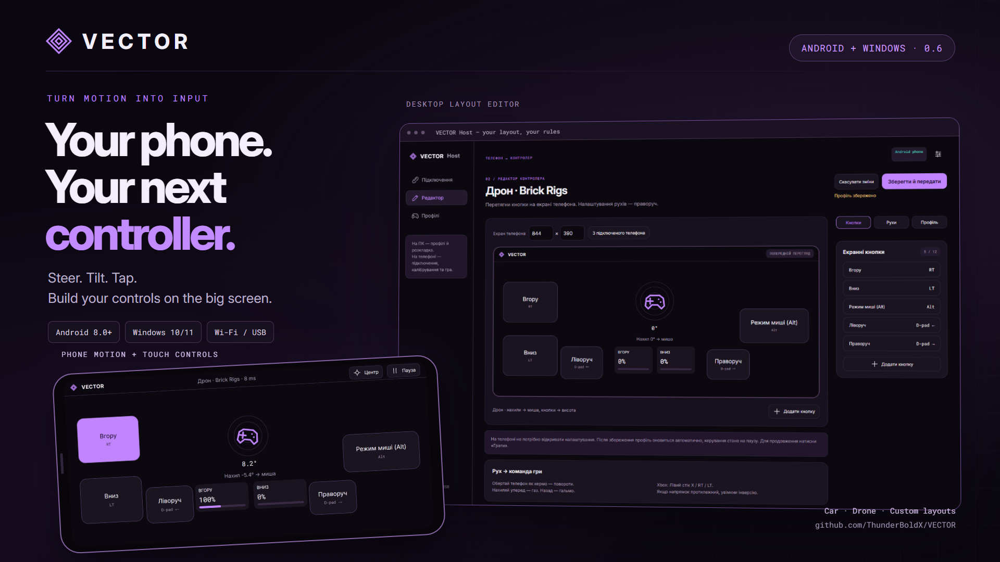

# VECTOR 0.6.0 · Your phone. Your next controller.

**First public GitHub release.** Turn your Android phone into a motion controller for Windows games: steering and pedals for cars, tilt-to-mouse for drones, or a custom touch-button layout.

## Download & install

Install **both** files:

- **[Windows Host installer](https://github.com/ThunderBoldX/VECTOR/releases/download/v0.6.0/VECTOR-Host-Windows-0.6.0-Setup.exe)** — Windows 10/11 x64.
- **[Android APK](https://github.com/ThunderBoldX/VECTOR/releases/download/v0.6.0/VECTOR-Android-0.6.0.apk)** — Android 8.0+ with compatible motion sensors.
- [Source archive](https://github.com/ThunderBoldX/VECTOR/releases/download/v0.6.0/VECTOR-Source-0.6.0.zip), [SHA-256 checksums](https://github.com/ThunderBoldX/VECTOR/releases/download/v0.6.0/SHA256SUMS-0.6.0.txt), and a validation report are included below.

[Installation guide](https://github.com/ThunderBoldX/VECTOR/blob/v0.6.0/docs/INSTALL.md) · [Інструкція українською](https://github.com/ThunderBoldX/VECTOR/blob/v0.6.0/docs/INSTALL_UK.md)

For Xbox RT/LT, install ViGEmBus using the button in Host and restart Host. Pair the phone using the PIN, calibrate, enable control on PC and press Play on the phone. Use one private Wi-Fi network or Android USB tethering. The app interface is Ukrainian.

## Included

- Car, universal and Brick Rigs drone presets.
- Desktop layout editor with up to 12 screen buttons and configurable hold/tap/toggle actions.
- Analog Xbox RT/LT, mouse/keyboard output, and optional separately configured vJoy.
- Independent X/Y mouse sensitivity, velocity and displacement modes.
- Remembered devices and authenticated reconnects without repeating a PIN.
- Live profile updates while the phone remains connected.

## Fixed in 0.6

Profile changes now stay saved after reopening the editor and restarting Host. Legacy duplicated backups are recovered, write errors are visible, and drafts survive failed saves. Editing pauses the phone; applying the same profile preserves the enabled connection and calibration. Press Play to continue without disconnecting.

## Update from a local build

Close the old Host before installing. Install the APK over the existing app; update both devices together. Existing profiles and remembered devices are retained. Very old versions without stored-device support need one PIN pairing.

## Validation & scope

The release passed 27 Node unit/UDP checks, Java motion and key-derivation checks, browser layout/pause/save checks, and packaged Host integration checks for real IPC, signed UDP configuration, restart persistence and remembered-device reconnection. Tests do not send OS input or install drivers. Automated checks are not physical-phone or game compatibility certification.

This is an input controller, not game streaming. Bluetooth/iOS and force feedback are not implemented. Mouse counts are not physical DPI; no zero-latency claim is made. ViGEmBus is a third-party archived project; driver installation is explicit.

---

## Українською

**VECTOR 0.6.0 — перший публічний реліз.** Телефон стає контролером для ПК: кермо й педалі для автомобіля, нахили для дрона та власні екранні кнопки. Редактор і всі налаштування — на ПК.

Завантаж Windows-інсталятор і Android APK вище. Для RT/LT встанови драйвер із Host, підключи телефон кодом, відкалібруй, увімкни керування на ПК та натисни «Грати» на телефоні.

Виправлено збереження профілів і застосування налаштувань без від’єднання: **пауза → зміни на ПК → «Зберегти й передати» → «Грати»**. Схеми підключення, USB-модем і вирішення проблем — у [повній інструкції](https://github.com/ThunderBoldX/VECTOR/blob/v0.6.0/docs/INSTALL_UK.md).
